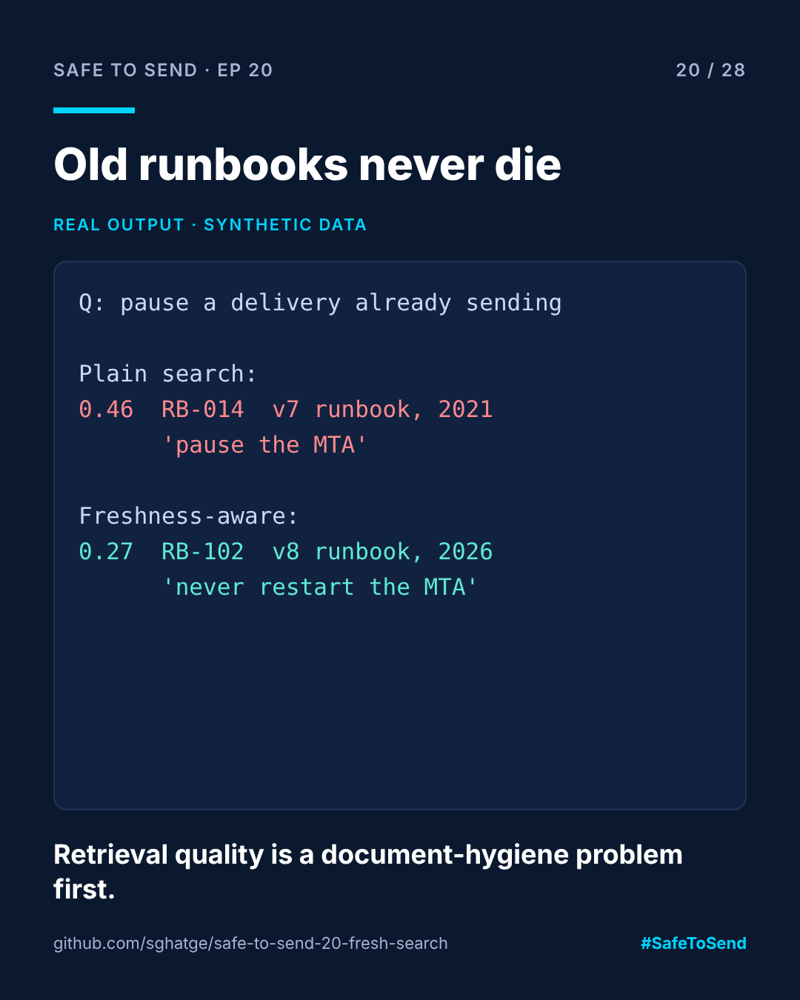

<div align="center">


**SAFE TO SEND · GOVERNED AI ENGINEERING SERIES · SAFE TO SEND 20 FRESH SEARCH**

[GitHub Profile](https://github.com/sghatge) · [Portfolio](https://sghatge.github.io/adobe-campaign-v8-governance/)

</div>

---

# safe-to-send-20 · Fresh Search



**Safe to Send · Episode 20** — a 28-day learn-in-public series on governing AI in CRM operations.

> Retrieval quality is a document-hygiene problem before it's an AI problem.

## The real-world scenario

You point an AI assistant at the team's runbooks. Someone asks how to pause a delivery that's already sending. The assistant confidently quotes a 2021 runbook for the old console, including "if the delivery does not pause, pause the MTA". The 2026 runbook says the opposite: never restart the MTA, it affects every market.

Why did the old one win? It repeats "pause" and "delivery" over and over. Old runbooks are often longer, wordier and better at matching keywords.

## Run it

```bash
python fresh_search.py examples/runbooks.json "how do I pause a delivery that is already sending"
```

## Real example output

```
Plain search: 'how do I pause a delivery that is already sending'
  0.46  RB-014   Pause a delivery during sending (v7 console)
  0.27  RB-102   Stop or pause an in-flight send (v8)
  0.16  RB-077   Quiet hours by market

Freshness-aware: 'how do I pause a delivery that is already sending'
  0.27  RB-102   Stop or pause an in-flight send (v8)
  0.16  RB-077   Quiet hours by market  [past review date (2025-01-15): verify before use]
  0.02  RB-110   Incident log template
```

The fix is metadata, not a better model: each runbook declares what it `supersedes` and a `review_by` date. Superseded documents are dropped from results, and anything past review is labelled "verify before use".

## Before you build retrieval

1. Add `supersedes` when you replace a runbook. Don't just add the new one.
2. Give every runbook a review date.
3. Treat retrieval tests like golden tests: a known question must return the current answer.

MIT · [Sangram Ghatge](https://www.linkedin.com/in/sangram-g-2369705b) · #SafeToSend
